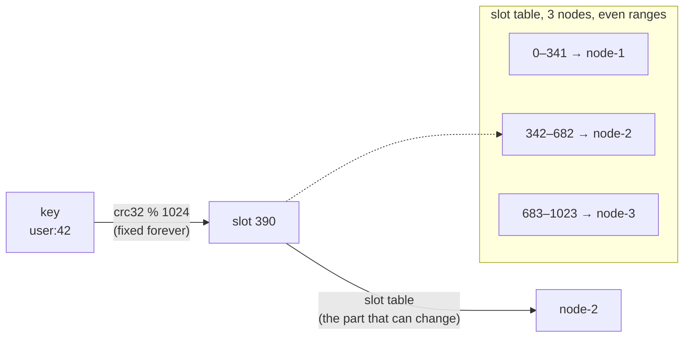
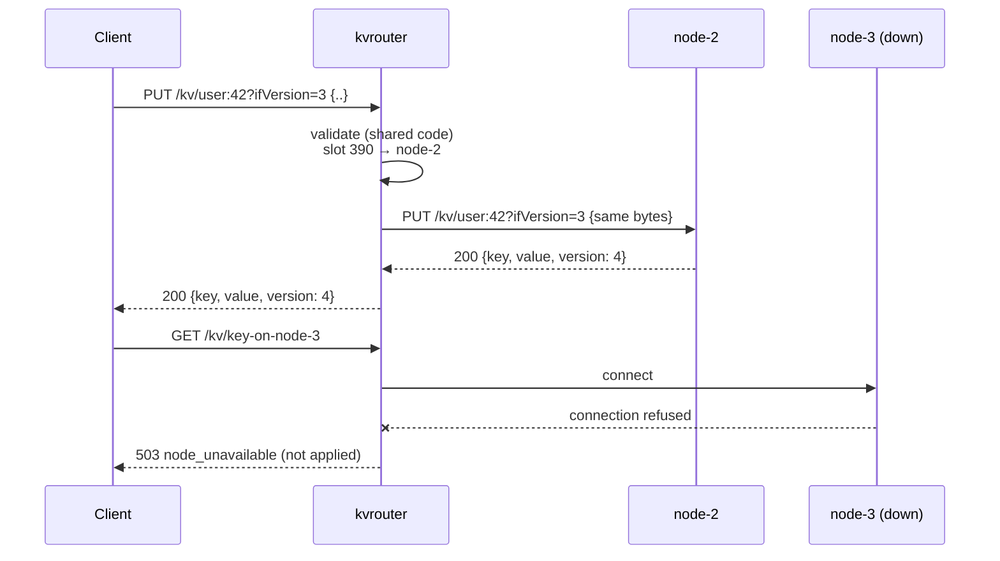
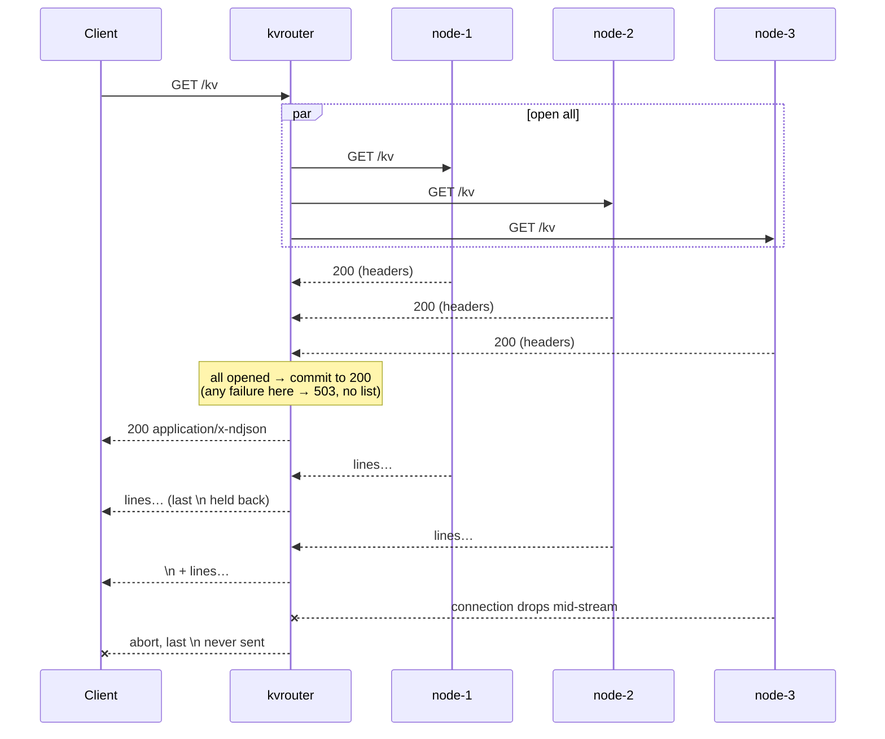

# Multi-node KV Store: Decisions

The decision record behind [`solution.md`](solution.md): each decision, the approaches considered, and
their pros and cons. Each node runs the single-node design unchanged
([`../key-store-value-single-node/decisions.md`](../key-store-value-single-node/decisions.md)). This file
only covers what's added on top: routing, key placement, and listing across nodes.

---

## Summary

| # | Decision | Choice |
|---|---|---|
| M1 | Where routing happens | A stateless router in front of the nodes |
| M2 | Partition function | 1024 fixed slots, split into even ranges per node |
| M3 | Hash function | CRC32 (IEEE) |
| M4 | Topology config | One `cluster.json` read by the router; nodes trust the router |
| M5 | Where validation runs | Router and node both validate, with shared code |
| M6 | Forwarding a key request | Hand-written `http.Client` forward, explicit error mapping, no retries |
| M7 | `GET /kv` across nodes | Open all node streams first, then copy them in order |
| M8 | Packaging | Two binaries: `kvnode` and `kvrouter` |

---

## M1. Where routing happens

The requirements say clients use one URL and never see the nodes.

**approach 1:** smart client. The client computes the owner and calls the node directly (Redis Cluster,
DynamoDB SDKs). Not working ❌ here. Clients would have to know the nodes, and plain curl stops working.

**approach 2:** any-node forwarding. One node is the public endpoint and forwards keys it doesn't own.
- pros: no extra process.
- cons: that node does two jobs (storage and routing), about 2/3 of requests still take an extra hop, and
  the listing logic lives inside a storage node.

**approach 3: stateless router (use).** A separate process on `:7000` works out each key's owner and
forwards the request. Nodes stay plain single-node servers.
- pros: clients and the brief's curl commands work unchanged. Routing and listing live in one place. The
  router holds no data, so more copies can run behind a load balancer.
- cons: one extra network hop per request. A single point of failure (HA is out of scope), though a restart
  loses nothing.

use approach 3 because it keeps clients unchanged and keeps nodes simple: all of the multi-node logic is in
one process.

---

## M2. Partition function

Every process must answer "which node owns `user:42`?" the same way, and the answer must spread keys
evenly.

**approach 1:** hash and modulo: `node = hash(key) % N`.
- pros: the simplest possible mapping, with even spread.
- cons: adding a node later moves about 3/4 of all keys (3 → 4 nodes). Ownership is implicit, so there's
  nothing to point at or move. Removing a dead node also reshuffles keys on healthy nodes.

**approach 2:** consistent-hash ring with virtual nodes. Each node is placed at many points on a hash
circle, and a key belongs to the first point clockwise (Memcached ketama, Dynamo, Cassandra).
- pros: adding a node moves only about 1/N of keys.
- cons: ownership is scattered over thousands of small arcs, which is hard to print or move on purpose.
  Balance depends on the number of virtual points. The ring must be rebuilt identically in every process.

**approach 3: fixed slots + table (use).** Two steps: `slot = hash(key) % 1024` is fixed forever, and a
table maps each slot to a node (Redis Cluster, Couchbase vBuckets).
- pros: ownership is explicit and printable: `user:42` → slot 390 → node-2. Later, replication, failover and
  rebalancing move whole slots, which is the unit Part 3 needs.
- cons: with a fixed node list it behaves just like modulo today, so the benefit only shows later. The slot
  count caps the number of nodes, and changing it after data exists means moving keys.

use approach 3 because it costs almost nothing over modulo now and gives Part 3 its unit of ownership.



**Slot ranges:** split evenly in the order nodes appear in `cluster.json`, so each node gets ⌊1024/N⌋ or
⌈1024/N⌉ slots (3 nodes: 342 / 341 / 341).

**Why 1024:** it needs to be much larger than the node count so ranges come out even. 1024 keeps the
worst-case imbalance at one slot (about 10% even at 100 nodes) and is small enough to print in a demo.
Redis uses 16384 because it sends a slot bitmap in every heartbeat and plans for ~1000 nodes; this system
needs neither.

---

## M3. Hash function

The hash must give the same result in every process and, ideally, in any language a future client uses.

**approach 1:** Go's `hash/maphash` (or Go's built-in map hash). Not working ❌. It is randomly seeded per
process, so the router and the nodes would disagree on every key.

**approach 2:** Java's `String.hashCode`. Not working ❌. It is defined only in Java, so Go and other languages
would have to copy it, and it spreads similar keys poorly.

**approach 3:** SHA-256 (truncated).
- pros: stable everywhere, excellent spread, in every standard library.
- cons: a cryptographic hash, much slower than needed for picking a slot.

**approach 4:** FNV-1a (64-bit).
- pros: in Go's standard library, mixes similar keys better than CRC32.
- cons: less common across languages (usually reimplemented by hand), and not much better for this
  use.

**approach 5:** xxHash.
- pros: very fast, excellent spread, widely used for sharding.
- cons: needs a third-party dependency, which breaks "standard library only".

**approach 6: CRC32 IEEE (use).**
- pros: in Go's standard library, and the same algorithm as Java's `java.util.zip.CRC32` and Python's
  `zlib.crc32`, so any future client in those languages computes the same slot. Hardware-accelerated, so
  it's very fast.
- cons: built for error detection, not for resisting crafted keys. Someone could deliberately pile many
  keys onto one slot. That's acceptable with trusted clients (no auth, out of scope).

use approach 6 because it's stable across processes and languages, needs no dependency, and its spread is
more than good enough. Measured on Go 1.27, 30,000 keys over 3 nodes:

| Key pattern | node-1 | node-2 | node-3 |
|---|---|---|---|
| random `k-<hex>` | 98.7% | 100.2% | 101.2% |
| `user:0` … `user:29999` | 100.0% | 100.0% | 100.0% |
| `counter-0` … `counter-29999` | 100.1% | 99.8% | 100.1% |

All are well inside the required 90–110%.

---

## M4. Topology config

**approach 1:** router flags only, e.g. `-nodes=node-1=http://localhost:7001,…`.
- cons: long flags are error-prone, and a second router would need the same flags copied exactly.

**approach 2: one `cluster.json` read by the router; nodes trust the router (use).**
- The file lists node IDs and URLs in order. Slot ranges are computed from that order (M2).
- The router checks at startup: at least one node, no duplicate IDs, valid IDs. Otherwise it exits.
- Nodes don't read the file. They are started with their own `-node-id`, and the start script must use the
  same ID as `cluster.json`.
- pros: nodes stay exactly the single-node server. One file is the single source of truth for routing.
- cons: nothing checks that the URL in the file really points to the node with that ID. A mistake in the
  file or the start script would store keys on the wrong node, or report the wrong `node` in `GET /kv`. With
  one router and one file, that can only come from misconfiguration.

**approach 3:** shared file + nodes check ownership. Every node also reads `cluster.json` and refuses keys
outside its slots (421).
- pros: a misconfigured router can't put one key on two nodes.
- cons: nodes need the topology, and every request pays an extra check against a mistake that only a
  misconfiguration can cause.

use approach 2 because, with a single router and a single file, there is only one view of ownership. The
node-side check (approach 3) is the natural next step once there are several routers or a changing
topology (Part 3).

```json
{
  "nodes": [
    { "id": "node-1", "url": "http://localhost:7001" },
    { "id": "node-2", "url": "http://localhost:7002" },
    { "id": "node-3", "url": "http://localhost:7003" }
  ]
}
```

---

## M5. Where validation runs

A bad request (key, `ifVersion`, body, size, method) must still get its 400/405/413 when the owning node is
down.

**approach 1:** the router checks only the key, which it needs for routing, and passes everything else to
the node. Not working ❌. With the owner down, a bad body would get 503 instead of 400.

**approach 2: router and node both validate, with shared code (use).**
- The router runs the same dispatcher and validation as a node, from a package both binaries import. A bad
  request is rejected at the router with exactly the error a single node would return.
- The router reads the body (up to 1 MiB) to validate it, then forwards the same bytes untouched.
- The node validates again, so it's still safe if called directly.
- pros: identical errors with or without nodes, from one implementation.
- cons: the body is validated twice and held in router memory for the duration of the request (bounded by
  1 MiB).

use approach 2.

---

## M6. Forwarding a key request

**approach 1:** `httputil.ReverseProxy`, Go's standard reverse proxy.
- pros: handles headers and streaming for you.
- cons: its main strength, streaming the body, no longer matters once the router has read and validated it
  (M5). Error handling is hidden in a callback, so the 503/504/502 mapping is less obvious to explain.

**approach 2: hand-written `http.Client` forward (use).**
- Build the node request from the raw path, the raw query string and the buffered body, send it, and copy
  the node's status, headers and body back to the client.
- pros: every step and every error case is explicit.
- cons: a little more code than the reverse proxy.

use approach 2.

**Error mapping**

| What happened | Response | Was the write applied? |
|---|---|---|
| Couldn't connect to the node | 503 `node_unavailable` | No |
| Sent, but no reply within the node timeout, or the connection dropped | 504 `node_timeout` | Unknown |
| The node replied with something that isn't a valid response | 502 `bad_node_response` | Unknown |

**Details**
- No retries. The router never resends a request. (Go's HTTP client also never retries PUT or PATCH by
  itself.) A retried write could raise the version twice.
- One shared connection pool for all nodes, keeping up to 128 idle connections per node. Go's default is 2,
  which under the counter test keeps opening and closing connections.
- The node timeout comes from a router flag (default 2s).



---

## M7. `GET /kv` across nodes

The rules: if any node is down before the response starts, return 503 and no list. If a node fails
partway, the body must not end with `\n`, so the client can tell it's incomplete.

**approach 1:** collect every node's list in router memory, then reply.
- pros: clean all-or-nothing. Could even sort.
- cons: router memory grows with the total number of keys, which undoes the point of scaling out.

**approach 2:** contact nodes one after another and stream each list. Not working ❌. A down second node is
only found after 200 has been sent, so the router can't return 503.

**approach 3: open all first, then copy in order (use).**
- Send `GET /kv` to every node in parallel and wait until each has answered with its headers. If any fails,
  return 503 and nothing else.
- Otherwise send 200 and copy each node's stream to the client in turn, in `cluster.json` order. The router
  holds only a small buffer, whatever the number of keys.
- **Holding back the last newline:** the router delays writing the final `\n` it has copied until more data
  or a clean end arrives. If a node fails mid-stream, the router aborts the connection without that
  newline, so the body never ends cleanly on a failure.
- If a node stops sending in the middle of its stream for longer than the node timeout, the router treats
  it as a failure.
- pros: catches the common failure (a node down) before committing to 200, with constant router memory.
- cons: later nodes wait while earlier ones are copied (harmless: nodes hold no locks while streaming). A
  node can still fail mid-stream, which is why the newline rule exists.

use approach 3.



---

## M8. Packaging

**approach 1:** one binary with two modes (`kv node …`, `kv router …`).
- pros: one build target, and shared code needs no extra setup.
- cons: one binary carries flags for both roles, so each mode has to ignore the other's flags.

**approach 2: two binaries, `kvnode` and `kvrouter` (use).**
- `kvnode -addr :7001 -node-id node-1`: the single-node server, unchanged.
- `kvrouter -addr :7000 -cluster cluster.json -node-timeout 2s`.
- Shared code (validation, routing, slot function) lives in internal packages both import.
- A start script launches 3 nodes and 1 router for the demo, using the IDs and ports from `cluster.json`.
- pros: each binary has one job and only its own flags. The node binary is exactly what Part 1 ships.
- cons: two build targets.

use approach 2.
