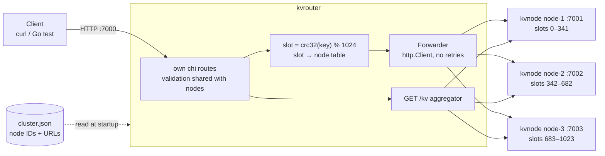
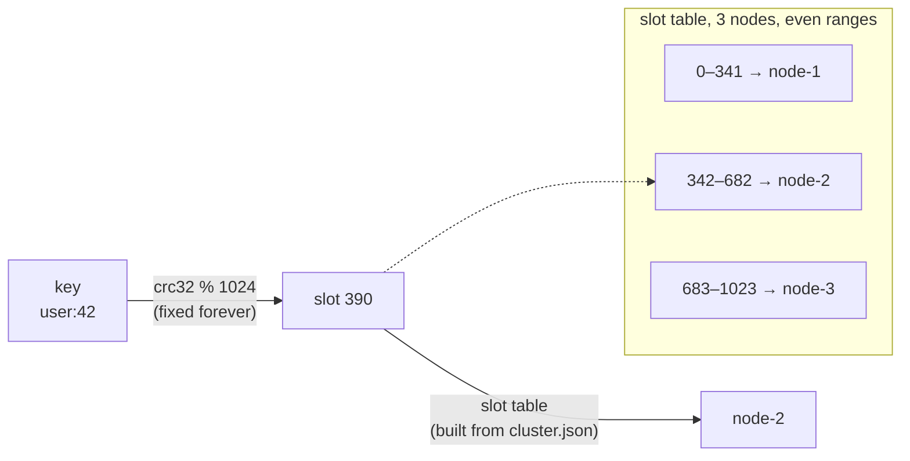
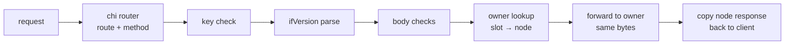
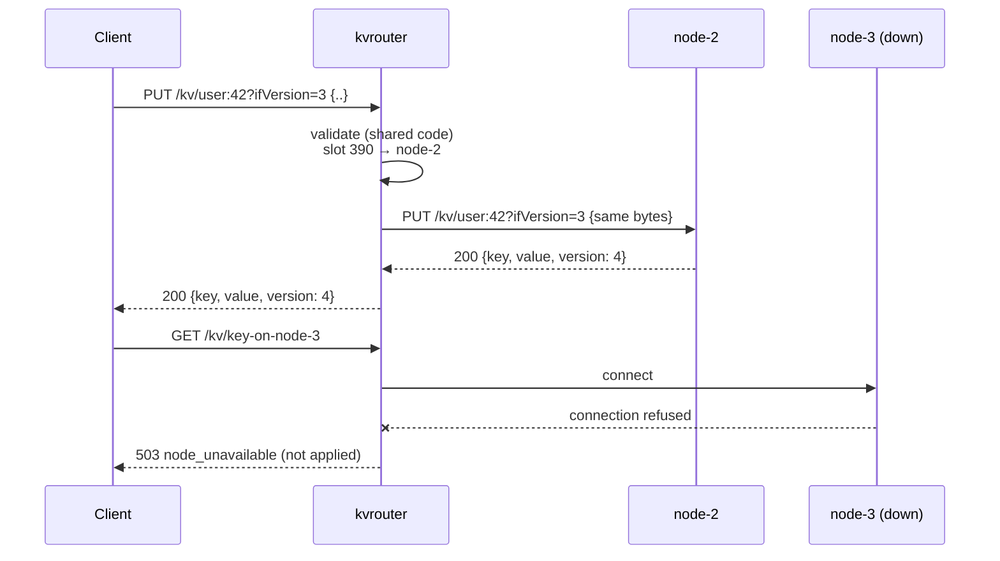
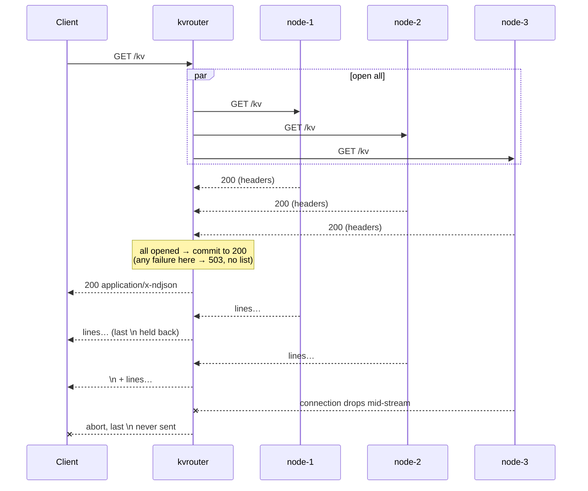

# Multi-node KV Store: Solution

How the multi-node deployment is built: its parts and how a request flows through them. What it must do is
in [`requirement.md`](requirement.md). Why each choice was made, and what else was considered, is in
[`decisions.md`](decisions.md). How to check it works is in [`verify.md`](verify.md).

Each node is the single-node service, unchanged
([`../key-store-value-single-node/solution.md`](../key-store-value-single-node/solution.md)). This file
covers only what's added on top: the router, key placement, and listing across nodes.

---

## 1. At a glance

Clients talk to one router on `:7000`. The router validates each request with the same code a node uses,
works out which node owns the key, and forwards the request there. It holds no data. `GET /kv` is answered
by streaming every node's list through the router.



---

## 2. Key placement

Every key belongs to exactly one node, found in two steps:

1. **Key → slot**: `slot = crc32(key) % 1024`. This never changes.
2. **Slot → node**: a table built at startup from `cluster.json`. The 1024 slots are split into even,
   contiguous ranges in the order the nodes are listed.



The table is built once and never changes while the router runs, so looking up an owner needs no lock.
Nodes don't know the table. They store whatever the router sends them.

---

## 3. Request handling in the router

### Lifecycle of a key request



- Steps up to the body checks are the **same code** as in a node. A bad request is rejected at the router
  with exactly the error a single node would return, even when its owner is down.
- The router reads the body (up to 1 MiB) to check it, then forwards it with the raw path and query
  string. It forwards the body with surrounding whitespace trimmed, which is exactly what the node would
  store anyway (single-node R-FID-1). No client headers are forwarded.
- The node validates again, then does the real work (version check, write) under its own per-key lock.
  The router takes no locks.

### When a node misbehaves

| What happened | Response | Was the write applied? |
|---|---|---|
| Couldn't connect to the node | 503 `node_unavailable` | No |
| Sent, but no reply within the node timeout, or the connection dropped | 504 `node_timeout` | Unknown |
| The node replied with something that isn't a valid response | 502 `bad_node_response` | Unknown |

How the router tells them apart, using an `httptrace` hook on each node request:

| Signal | Response |
|---|---|
| The request was never written to a connection (refused, unreachable, or the node timeout ran out while connecting) | 503 |
| Written, then the node timeout ran out, or the connection closed before any reply byte | 504 |
| Reply bytes arrived but Go's HTTP client couldn't parse them | 502 |
| A parsed reply whose body was cut off | 504 |
| A full reply whose status a node never sends (anything but 200, 400, 404, 405, 409, 413) | 502 |
| Otherwise | copy the node's status, `Content-Type`, `Allow` and body |

- The router reads the node's **whole** reply before answering. If it streamed the reply instead, a node
  that dropped halfway would leave the client holding a 200 with a cut-off body, with no way to send 504.
- The router never retries. A resent write could raise the version twice.
- One shared connection pool keeps up to 128 idle connections per node (Go's default of 2 would keep
  opening and closing connections under load).



---

## 4. `GET /kv` across nodes

1. **Open all.** The router sends `GET /kv` to every node in parallel and waits until each has answered
   with its headers. If any node fails here (can't connect, no headers within the node timeout, or a
   status other than 200), the client gets 503 and no list.
2. **Copy in order.** The router sends 200 and flushes it at once, then copies each node's stream to the
   client in turn, in `cluster.json` order, flushing each chunk. Each node already writes its own ID in
   every line, so the router copies bytes without reading them. Router memory stays small whatever the
   number of keys.
3. **Hold back the last newline.** The router delays the final `\n` it has copied until more data or a
   clean end arrives. If a node fails mid-stream, goes quiet for longer than the node timeout, or ends
   its stream mid-line, the router aborts the connection with `panic(http.ErrAbortHandler)` without that
   newline. The client sees a body that doesn't end in `\n` **and** a broken transfer (curl reports
   error 18), so a failed listing never looks complete. Flushing every chunk matters here: an abort
   throws away whatever is still buffered, and the client must at least get the 200 and the lines
   copied so far.



---

## 5. Configuration and running

Two binaries. `kvnode` is the single-node server, unchanged. `kvrouter` is the router.

```bash
kvnode   -addr :7001 -node-id node-1
kvnode   -addr :7002 -node-id node-2
kvnode   -addr :7003 -node-id node-3
kvrouter -addr :7000 -cluster cluster.json -node-timeout 2s
```

`docker compose up --build -d` runs this deployment in containers (`Dockerfile`, `compose.yaml`): one image
holding both binaries, three node services that take their ID from `KV_NODE_ID`, and the router. The
router's topology is written inline in `compose.yaml`, with the Compose service names as URLs
(`http://node-N:7000`). The README lists the commands for logs and for killing and restarting a node.

`cluster.json` is the same topology for a router running on the host, e.g. under the debugger
(`make debug-router` or the VS Code "kvrouter" launch config), against the containers' nodes published on
`localhost:7001`–`7003`.

| `kvrouter` flag | Default | Notes |
|---|---|---|
| `-addr` | `:7000` | Listen address for clients |
| `-cluster` | — | Path to `cluster.json` (required) |
| `-node-timeout` | `2s` | Per-request timeout to a node |

`cluster.json`, read only by the router:

```json
{
  "nodes": [
    { "id": "node-1", "url": "http://localhost:7001" },
    { "id": "node-2", "url": "http://localhost:7002" },
    { "id": "node-3", "url": "http://localhost:7003" }
  ]
}
```

- At startup the router checks: at least one node, valid IDs, no duplicates, absolute `http(s)` URLs, and
  no unknown fields. Otherwise it exits.
- Each node's `-node-id` must match its entry in `cluster.json`. Nothing checks this automatically; the
  Compose file keeps them in sync: each service's `KV_NODE_ID` matches its service name and its topology ID.

---

## Decisions

Full reasoning, alternatives, and pros and cons for each: [`decisions.md`](decisions.md).

| # | Decision | Choice |
|---|---|---|
| [M1](decisions.md#m1-where-routing-happens) | Where routing happens | A stateless router in front of the nodes |
| [M2](decisions.md#m2-partition-function) | Partition function | 1024 fixed slots, split into even ranges per node |
| [M3](decisions.md#m3-hash-function) | Hash function | CRC32 (IEEE) |
| [M4](decisions.md#m4-topology-config) | Topology config | One `cluster.json` read by the router; nodes trust the router |
| [M5](decisions.md#m5-where-validation-runs) | Where validation runs | Router and node both validate, with shared code |
| [M6](decisions.md#m6-forwarding-a-key-request) | Forwarding a key request | Hand-written `http.Client` forward, explicit error mapping, no retries |
| [M7](decisions.md#m7-get-kv-across-nodes) | `GET /kv` across nodes | Open all node streams first, then copy them in order |
| [M8](decisions.md#m8-packaging) | Packaging | Two binaries: `kvnode` and `kvrouter` |
