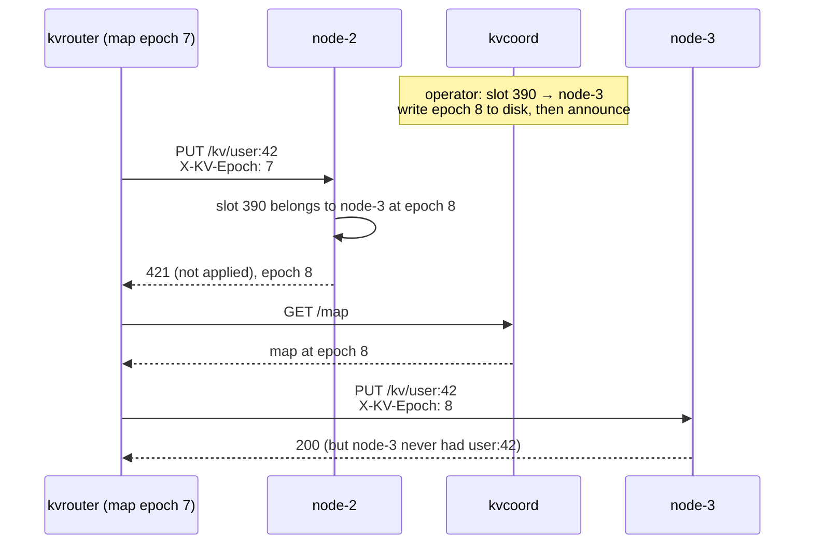
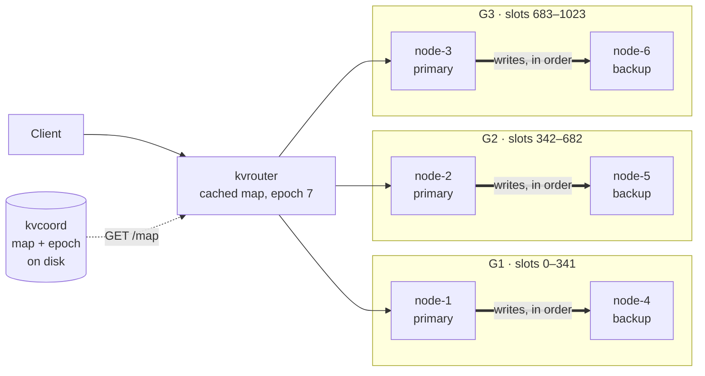
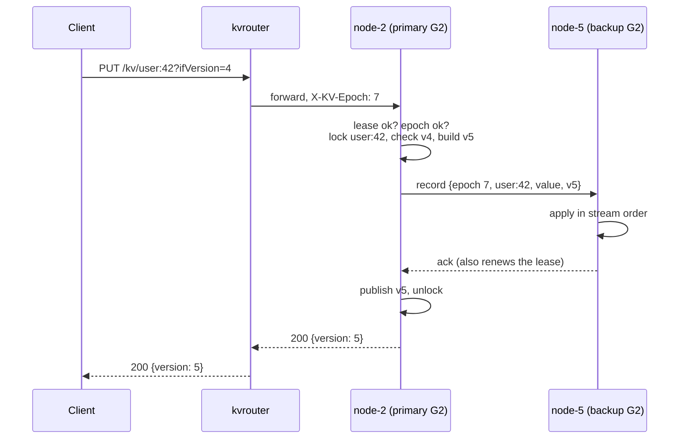
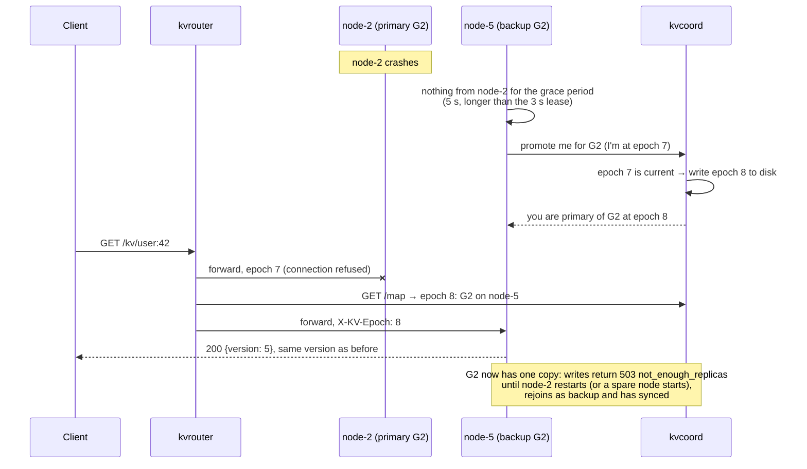
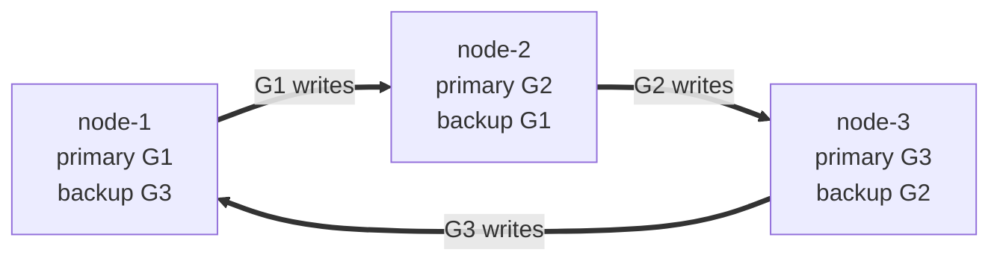
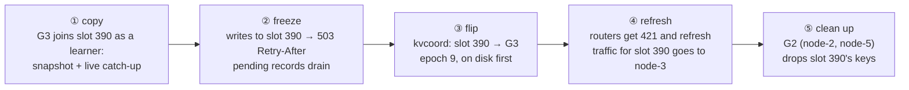

# KV Store: Roadmap (Part 3)

## Starting point

What Parts 1 and 2 built ([multi-node solution](../key-store-value-multi-node/solution.md)):

- One router on `:7000`. `slot = crc32(key) % 1024`, and a slot → node table built once from
  `cluster.json`.
- Every node is the only copy of its slots, held in memory only. Nodes don't check which slots they own
  (they trust the router, [M4](../key-store-value-multi-node/decisions.md#m4-topology-config)).
- **The gap:** if a node dies, its keys (about 1/N of all data) return 503 until it restarts, and then
  they are gone.

The store is treated as the **source of truth**, so losing a write that was answered 200 is the worst
failure. That is why replication and failover is the headline item.

---

## 1. Changeable Slot Map (foundation)

**In one line:** let the slot → node map change while the cluster runs, and make every node refuse keys
it doesn't own.

**Today** the router builds the slot → node map once at startup and can't change it while running, and
nodes never check which slots they own.

### Diagram

A slot is reassigned from `node-2` to `node-3` while a router still holds the old map:

### Benefits

- **No user-visible benefit on its own.** Changing an owner without moving the data loses keys, as the
  diagram shows: `node-3` answers for `user:42` but has never seen it.
- **The base for section 2 (failover) and section 3 (resharding):** both change the owner of some slots.
- **A misconfigured router can no longer store a key on the wrong node**, because nodes now check
  ownership.

### Tradeoffs

- **One more process, `kvcoord`.** It is not on the data path: routers and nodes cache the map, so
  traffic keeps flowing while it is down.
- **One epoch for the whole map** makes every router refresh on any change, even for slots it isn't
  using.
- **One extra round trip** (421, refresh, retry) for each router after each map change.
- **An ownership check on every node request.**

---

## 2. High Availability by Replication and Failover

**In one line:** every group of slots gets a primary and one synchronous backup. A write is answered 200
only after the backup has applied it. This is a CP choice (consistency over availability): when a group
can't keep two copies, it refuses writes rather than risk losing them. An AP choice suits a cache, not a
source of truth that relies on `ifVersion`. When a primary dies, `kvcoord` promotes the backup using the
changeable map from section 1.

**Goal:** losing any one node loses no acknowledged write, and doesn't change what `version` and
`ifVersion` mean.

### Diagram: replication

3 groups on 6 nodes, replication factor (RF) 2. Each node has one role in one group: primary or backup.
Routers send requests to primaries only. Each thick arrow is the group's **replication stream**: one
long-lived connection that carries every write of the group, in order, from its primary to its backup.
Groups never sync with each other, because each key lives in exactly one group.

One write to `user:42` (slot 390, group G2):

### Diagram: failover

Only G2 is affected: G1 and G3 keep both copies and keep taking writes. If a backup dies instead (say
`node-5`), G2 keeps serving reads but refuses writes until a new backup has synced.

### Benefits

- **No acknowledged write is lost when any one node dies.** Today a third of the keys (with 3 nodes) are
  gone for good.
- **If a primary dies, reads on its slots come back in about 5–6 s** (grace period plus map refresh), with no
  operator. Writes resume once a new backup has synced.
- **Versions carry over unchanged**, so clients' `ifVersion` retry loops keep working. The API is the
  same.
- **Rolling restarts and deploys become safe** for an in-memory store.

### Tradeoffs

- **+1 round trip per write:** under 1 ms within an availability zone (AZ), a few ms across AZs.
- **2× memory and 2× nodes** (6 nodes for 3 groups), which gives back half of Part 2's capacity gain.
- **A group that loses either of its nodes stops taking writes** until a new backup has synced: seconds
  to tens of seconds, depending on data size. Only that group is affected.
- **Backup nodes serve no reads:** half the nodes buy safety, not throughput, and mostly sit idle.

### Other option: 3 nodes, each primary of one group and backup of another

The same design can run on 3 nodes, with each node primary of one group and backup of another. It uses
fewer nodes and every node serves traffic. But when one node dies, two groups stop taking writes instead of
one.

---

## 3. Online Resharding and Rebalancing

**In one line:** move slots from one group to another while serving traffic, so the cluster can grow,
shrink, or cool down a busy node without downtime.

It uses the **changeable map** from section 1 to move ownership, and the **resync** from section 2
(snapshot + live catch-up) to copy the data, so it depends on both.

### Diagram

Example: `user:42` is hot, and it makes G2's primary, `node-2`, busy. Move its slot, 390, from G2 to the
quieter group G3 (`node-3` primary, `node-6` backup):

### Benefits

- **Scale out and in without downtime** and without editing `cluster.json`. Part 2's capacity goal,
  made elastic.
- **Cool down a hot node** by moving its busiest slots to quieter nodes.
- **Drain a node** before taking it out of service.

### Tradeoffs

- **A short write pause on the moving slots:** milliseconds to about a second, 503 with `Retry-After`.
- **Extra memory and network** while a copy runs.
- **A `GET /kv` that runs across a flip is cut off** and must be retried.
- **Moves a whole slot, never one key:** moving slot 390 moves every key in it, and one hot key's load
  can't be spread across nodes.

