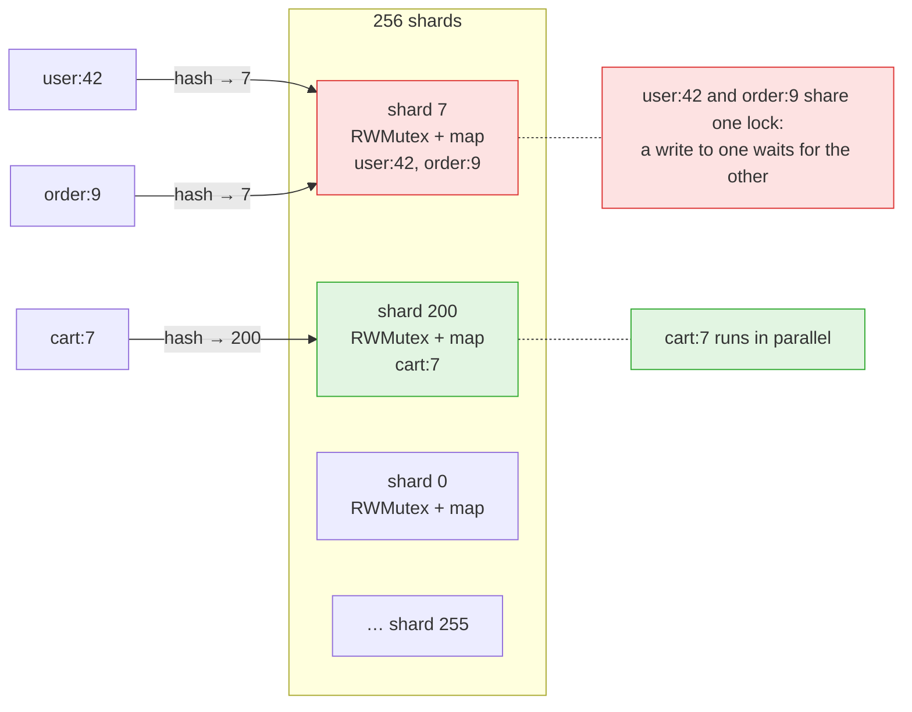
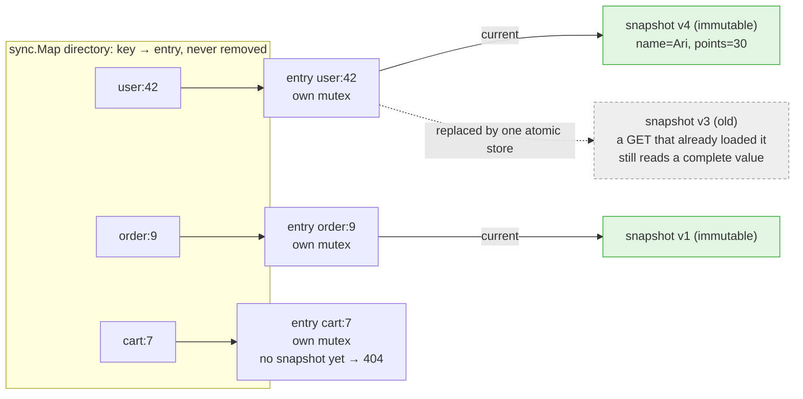
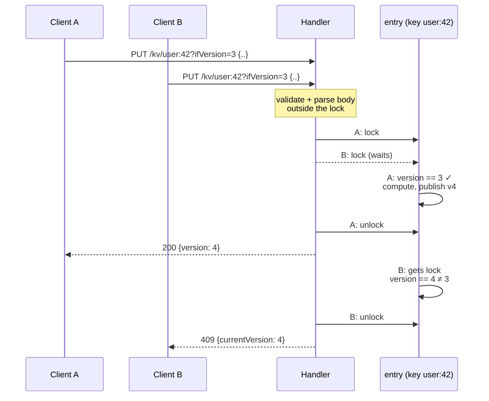
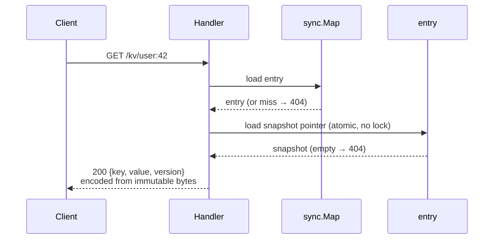
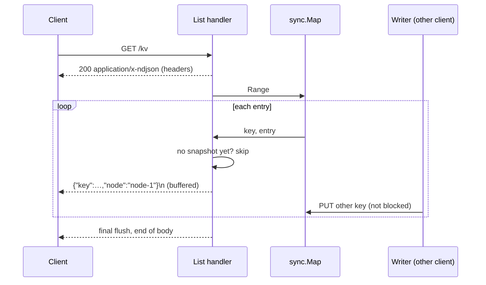

# Single-node KV Store: Decisions

The decision record behind [`solution.md`](solution.md): each decision, the approaches considered, and
their pros and cons. Behavior (status codes, edge cases, versioning) is defined in
[`requirement.md`](requirement.md) and not repeated here.

Multi-node decisions (partition function, hash, routing, fan-out) live in
[`../key-store-value-multi-node/decisions.md`](../key-store-value-multi-node/decisions.md).

---

## Summary

| # | Decision | Choice |
|---|---|---|
| S1 | Language / stack | Go, standard library only |
| S2 | How to store values and lock | Per-key mutex + `sync.Map` directory + immutable snapshot |
| S3 | Value representation | Raw bytes, not re-encoded; response built by hand |
| S4 | What runs inside the lock | Only check → compute → publish |
| S5 | PATCH merge | Decode top level only, overlay, re-encode |
| S6 | `GET /kv` (part 2) | Stream inside `sync.Map.Range` |
| S7 | Process config | Flags with env fallback; `http.Server` with timeouts |

---

## S1. Language / stack

**approach 1: Go, standard library only (use).**
- pros: my main programming language right now. Real parallelism, so locking is actually exercised rather
  than provided by the runtime. The race detector. One binary, no dependencies.
- cons: not the company's stack (Java/Quarkus). Default JSON decoding turns numbers into `float64` (see S3).

**approach 2:** Java 21 + Quarkus.
- pros: the company's stack. Jackson keeps big numbers exact.
- cons: more framework behavior to defend (event loop vs worker threads, CDI). Scaffolding eats the
  timebox.

// plain Java without Quarkus is skipped: the cost of both, the benefit of neither.

use approach 1 because the assignment is about concurrency, and Go is built for it: goroutines run
truly in parallel across cores, the standard library has the locks and atomics this design needs
(`sync.Mutex`, `sync.Map`, `atomic.Pointer`), and the race detector catches concurrency bugs in tests.

No `ServeMux`: routing is a small hand-written dispatcher on the raw path. Go's standard router redirects
`/kv/..`, answers HEAD with 200, returns plain-text 405s, and decodes `%3A` in keys (verified). Its query
parser also silently drops a malformed `ifVersion`, which would turn a guarded write into an unconditional
one, so `ifVersion` is parsed by hand.

---

## S2. How to store values and lock

Needed: same key serialized, different keys concurrent, no torn reads, no lost updates, and listing that
doesn't stall writes.

**approach 1:** plain map, no lock. Not working ❌. Concurrent map writes crash the Go runtime, and
check-then-write races lose updates.

**approach 2:** one global `Mutex` / `RWMutex`.
- cons: every write waits for every other write, even on different keys. `RWMutex` only lets reads run in
  parallel.

**approach 3:** sharded `RWMutex` (256 shards). Each key hashes to one of 256 shards, and each shard has its
own lock and map.
- pros: a fixed number of locks. Critical sections take microseconds, so a collision costs little.
- cons: two unrelated keys in the same shard (1-in-256 chance) block each other, which is allowed only as
  "incidental contention". Listing has to copy keys shard by shard to avoid holding a lock during I/O. In
  Part 3, a shard lock held across a replication round trip would block 1/256 of all keys, so it would
  have to be replaced.



**approach 4: per-key lock with a `sync.Map` directory (use).**
- The directory maps key → entry. An entry is created once and never removed (there's no DELETE).
- Each entry has a mutex for writers and an atomic pointer to its current snapshot.
- A snapshot (value + version) is immutable once published.
- A write locks the entry, checks `ifVersion`, computes the new value, publishes a new snapshot with one
  atomic store, and unlocks.
- A read loads the entry and its snapshot pointer, with no lock at all.
- pros: exactly what the requirement asks: unrelated keys never share a lock. Reads never block and never
  see half a write. The directory is the access pattern `sync.Map` is documented for ("written once, read
  many"). Its `Range` doesn't block other operations, which gives lock-free listing (S6). Works unchanged
  in Part 3.
- cons: a few dozen bytes of lock state per key, kept forever (fine with no DELETE). Two structures to
  explain. `sync.Map` is untyped, so it needs a small typed wrapper.



Each key has its own lock, so writes to `user:42` never wait for `order:9`. A write builds a new snapshot
and swaps the pointer. Readers never lock: they get either the old snapshot or the new one, never a mix.

// also considered: lock-free CAS and actor-per-shard. CAS recomputes merges under contention and can't
// hold a network round trip (Part 3). Actors serialize reads too and need channel plumbing.

use approach 4 because it gives true per-key isolation, lock-free reads and listing, and needs no rework
for Part 3.

Edge cases this design must handle
- Guarded write on a missing key: return 409 straight from the directory lookup, and don't create an
  entry.
- Empty entry: a brand-new entry has no snapshot until its first write lands. GET treats it as 404, and
  `GET /kv` skips it, so no phantom keys appear.
- Two first writers race: both get the same entry from `LoadOrStore` and take turns on its mutex. The
  second one sees version 1.

### Write path (two clients race with the same `ifVersion`)



### Read path



---

## S3. Value representation

Needed: GET after PUT returns the exact body text (minus surrounding whitespace). After a PATCH merge, only
the meaning has to match.

**approach 1:** decode into Go values (`json.Unmarshal` into `any`). Not working ❌.
`12345678901234567891` comes back as `12345678901234567000`. Field order, `1.0` and escapes are lost.

**approach 2:** decode with `UseNumber()`.
- pros: exact numbers, easy merge.
- cons: still loses the raw text (whitespace, order, escapes, duplicate names). Every GET re-encodes.

**approach 3:** raw bytes, compacted on write. Both source docs chose this.
- pros: smaller, and the same JSON with different whitespace is stored identically.
- cons: compaction removes inner whitespace, so GET no longer returns the exact text.

**approach 4: raw bytes trimmed of surrounding whitespace, never re-encoded (use).**
- PUT stores the body with leading/trailing whitespace trimmed. GET writes the bytes back as they are.
- pros: byte-exact fidelity: number text, duplicate names and whitespace all survive. GET does no JSON
  work.
- cons: whitespace costs memory. The response has to be built by hand (below).

use approach 4 because it's the only one that returns the exact text.

The response is built by hand, never with `json.Marshal`. `json.Marshal` compacts an embedded raw
value and rewrites `<`, `>` and `&` inside strings as `\u` escape sequences (verified), which would change the stored
text. The envelope is written as `{"key":…,"value":` + stored bytes + `,"version":…}`. Error bodies contain
no stored values, so they can use `json.Marshal`.

---

## S4. What runs inside the lock

**approach 1:** the whole request under the lock (read body, validate, merge, write response).
- cons: a slow client or a large upload holds that key's lock the whole time, so network I/O sits inside
  the critical section.

**approach 2: only check → compute → publish under the lock (use).**
- before: read, validate and parse the body.
- inside: load the current snapshot, check `ifVersion`, compute the new value (PUT: the body; PATCH: the
  merge), publish.
- after: write the response from the immutable snapshot.
- pros: no I/O under the lock, so it's held for microseconds.
- cons: the PATCH merge must stay inside, because it depends on the current value. Its cost is bounded by
  the 1 MiB body limit.

use approach 2.

---

## S5. PATCH merge

**approach 1: decode only the top level, overlay, re-encode (use).**
- decode the stored value and the delta into a map of field name → raw bytes, copy the delta's fields
  over, and encode it back with HTML escaping turned off.
- pros: nested values are never decoded, so nested numbers stay exact. `null` is stored as a literal
  `null`, and a nested object replaces the old one, as the requirements say.
- cons: top-level fields come out sorted (Go encodes maps in key order), and nested values get compacted.
  Both are allowed after a merge. With duplicate names the last one wins, which is also allowed.
- example:
  ```text
  stored   {"name": "Ari", "points": 10, "profile": { "age": 30 }, "big": 12345678901234567891}
  delta    {"points": 30, "rank": "gold"}

  stored, top level only        after overlay
    name    → "Ari"               name    → "Ari"
    points  → 10                  points  → 30        (from delta)
    profile → { "age": 30 }       profile → { "age": 30 }
    big     → 12345678901234567891 big     → 12345678901234567891
                                  rank    → "gold"    (from delta)

  new stored value
           {"big":12345678901234567891,"name":"Ari","points":30,"profile":{"age":30},"rank":"gold"}
  ```
  `big` is never decoded as a number, so it stays exact. Fields come out sorted, and `profile` loses its
  inner spaces.

**approach 2:** splice bytes to keep the original order and formatting.
- pros: keeps field order and whitespace.
- cons: needs a hand-written tokenizer. A lot of work for something the requirements don't ask for.

use approach 1. A PATCH that creates a key stores the delta's raw bytes (S3), so re-encoding only
happens on a real merge.

---

## S6. `GET /kv` listing (part 2)

Needed: each key once, never block writers, weakly consistent.

**approach 1:** lock everything and take a snapshot. Not working ❌. Every write stalls for the whole
listing.

**approach 2:** collect all keys during `Range`, then write them.
- cons: memory grows with the number of keys, for no benefit, because `Range` is already lock-free.

**approach 3: stream inside `sync.Map.Range` (use).**
- for each entry: skip it if it has no snapshot yet, otherwise write one `{"key","node"}` line through a
  buffered writer that flushes periodically.
- `Range` holds no lock, so writers keep going. Keys that exist for the whole call are visited exactly
  once. Keys added during it may or may not appear, which is what the requirement allows.
- If the client disconnects, the write fails and the listing stops.
- pros: constant memory, no lock.
- cons: no ordering (allowed). A slow client keeps its own handler busy, but blocks nobody else.

use approach 3.



---

## S7. Process config and server settings

**approach 1: flags with env fallback (use).**
- `-addr` (env `KV_ADDR`, default `:7000`) and `-node-id` (env `KV_NODE_ID`, default `node-1`). A flag
  wins over env. An invalid node ID → exit at startup.
- pros: works for curl demos, scripts and containers.
- cons: two sources for a value, so the precedence has to be documented.

**approach 2:** flags only. Containers and compose files must pass flags explicitly.

**approach 3:** config file. Overkill for two settings. (The multi-node topology will need one.)

use approach 1.

Server settings: use `http.Server`, not bare `ListenAndServe`, which has no timeouts.

| Setting | Value | Why |
|---|---|---|
| Read-header timeout | 5s | Slow clients can't hold connections open |
| Read timeout | 10s | Bounds a slow 1 MiB upload |
| Idle timeout | 60s | Reuses keep-alive connections without leaking them |
| Write timeout | none | `GET /kv` streams can legitimately be long |
| Shutdown | graceful on SIGINT/SIGTERM, 5s limit | In-flight requests finish; the limit stops a long `GET /kv` stream from blocking exit |
