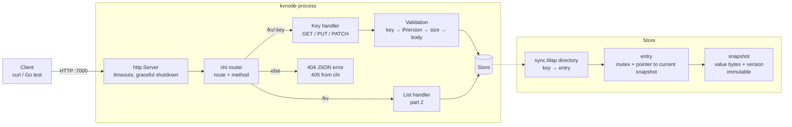
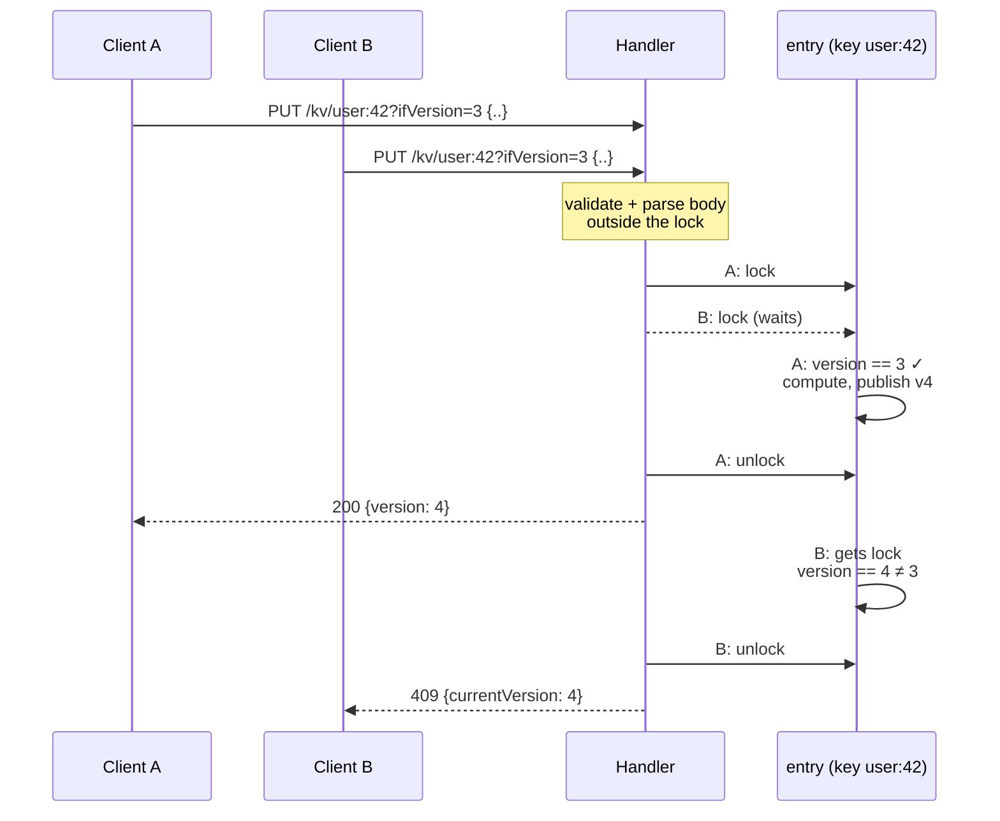
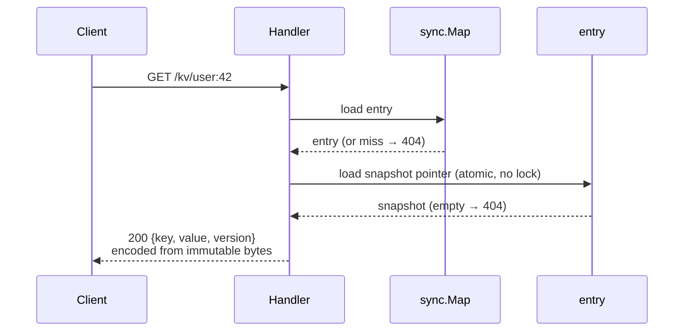
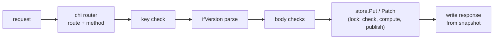
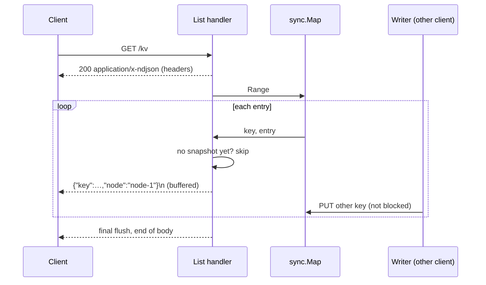

# Single-node KV Store: Solution

How the single-node service is built: its parts and how a request flows through them. What the service must do is in [`requirement.md`](requirement.md). Why each choice was
made, and what else was considered, is in [`decisions.md`](decisions.md). How to check it works is in
[`verify.md`](verify.md).

---

## 1. At a glance

One Go process: the standard library plus the chi router. An HTTP server hands every request to chi, which
validates it and calls an in-memory store. The store gives each key its own lock and keeps each value as an
immutable snapshot, so reads never lock and never see half a write.



---

## 2. Store

### Data model

| Piece | What it is | Changes? |
|---|---|---|
| Directory | A `sync.Map` from key to entry | An entry is added once per key and never removed |
| Entry | A mutex for writers + an atomic pointer to the current snapshot | The pointer is swapped on every write |
| Snapshot | Value bytes + version | Never. A write publishes a new one |

### Operations

- **Get(key)**: look up the entry, load its snapshot pointer. No lock. Missing entry or empty entry → not
  found.
- **Put(key, ifVersion, value)** and **Patch(key, ifVersion, delta)**: the two ways to write. Both go
  through one internal update path, so the code that runs under the lock stays inside the store:
  1. Look up the entry. If it's missing and `ifVersion` was given → conflict, and no entry is created.
     Otherwise create it (`LoadOrStore`, so racing creators share one entry).
  2. Lock the entry.
  3. Check `ifVersion` against the current snapshot → conflict if it doesn't match.
  4. Compute the new value (Put: the body; Patch: the delta on a new key, otherwise the merge).
  5. Publish a new snapshot with version + 1, then unlock.
- **Range(fn)**: visit every key that has a snapshot, without locking. Used by `GET /kv`.

### Write path (two clients race with the same `ifVersion`)



### Read path



---

## 3. Request handling

### Lifecycle of a write



Each step can stop the request with its error, in this order: 404/405 → 400 key → 400 `ifVersion` → 413 →
400 body → 409. Only the `Put` / `Patch` step holds a lock.

### Routing

`node.NewHandler` declares the node's chi routes, one plain `http.HandlerFunc` each. (`kvrouter` declares
its own routes; the two share only the `httpapi` checks and writers.) A key handler starts with
`httpapi.ParseKey` (GET) or `httpapi.ParseWrite` (PUT, PATCH), which run the checks after routing in R-ERR-4
order. chi routes on the still-encoded path, so `{key}` arrives undecoded (`user%3A42`
stays as sent and fails key validation):

| Path | Methods | Otherwise |
|---|---|---|
| `/kv` | GET → list | chi's 405: `Allow: GET`, empty body |
| `/kv/{key}` (one non-empty segment) | GET, PUT, PATCH → key checks, then the handler | chi's 405: `Allow` lists GET, PUT, PATCH in any order, empty body |
| anything else, including `/kv/` and `/kv/a/b` | — | 404 `not_found` (a custom chi NotFound handler) |

A chi middleware logs one line per request (method, path, status, bytes, duration), using chi's
response-writer wrapper to capture the status.

### Validation

- **Key**: the raw segment must match the allowed characters and length, and must not be `.` or `..`.
  Nothing is percent-decoded.
- **`ifVersion`**: parsed by hand from the raw query string, because Go's query parser silently drops
  malformed pairs. A bad value, a repeat or an overflow → 400.
- **Body**: size limit (413, chi `middleware.RequestSize` around `http.MaxBytesReader`) → valid UTF-8 →
  `json.Valid` → starts with `{` → nesting depth ≤ 64 (counted with `json.Decoder.Token`).

### Responses

- One writer for every JSON body: `json.Encoder` with `SetEscapeHTML(false)`. Plain `json.Marshal` would
  rewrite `<`, `>`, `&` inside stored strings as `\u` escapes.
- Success: `{"key","value","version"}`, with the stored bytes as a `json.RawMessage`. The encoder removes
  whitespace outside strings and keeps everything else (R-FID-1).
- Errors: `{"error","message"}` (+ `currentVersion` on 409).

---

## 4. Values and PATCH merge

- **PUT** stores the body with surrounding whitespace trimmed, as raw bytes. GET returns them with whitespace
  outside strings removed (R-FID-1).
- **PATCH on a missing key** stores the delta's raw bytes, the same as PUT.
- **PATCH on an existing key** merges inside the lock: decode only the top level of both sides into
  field → raw bytes, overlay the delta's fields, and encode back with HTML escaping off. Nested values are
  never decoded, so nested numbers stay exact. Fields come out sorted and nested values get compacted,
  which the requirements allow after a merge.

```text
stored   {"name": "Ari", "points": 10, "profile": { "age": 30 }, "big": 12345678901234567891}
delta    {"points": 30, "rank": "gold"}
result   {"big":12345678901234567891,"name":"Ari","points":30,"profile":{"age":30},"rank":"gold"}
```

---

## 5. `GET /kv` listing (part 2)

The list handler sends the headers, then walks the store with `Range`. For each key that has a snapshot it
writes one `{"key":…,"node":…}` line through a buffered writer that flushes periodically. No lock is held,
so writers carry on, and memory stays constant. If the client goes away, the write fails and the walk
stops.



---

## 6. Configuration and running

```bash
kvnode -addr :7000 -node-id node-1
# or
KV_ADDR=:7000 KV_NODE_ID=node-1 kvnode
```

| Flag | Env | Default | Notes |
|---|---|---|---|
| `-addr` | `KV_ADDR` | `:7000` | Listen address |
| `-node-id` | `KV_NODE_ID` | `node-1` | Must match `^[A-Za-z0-9_-]{1,64}$`, otherwise exit at startup |

A flag wins over env.

| Server setting | Value | Why |
|---|---|---|
| Read-header timeout | 5s | Slow clients can't hold connections open |
| Read timeout | 10s | Bounds a slow 1 MiB upload |
| Idle timeout | 60s | Reuses keep-alive connections without leaking them |
| Write timeout | none | `GET /kv` streams can legitimately be long |
| Shutdown | graceful on SIGINT/SIGTERM, 5s limit | In-flight requests finish; the limit stops a long `GET /kv` from blocking exit |

---

## 7. Known limits

- **Broken percent-escapes never reach the handler.** Go's HTTP server rejects a request line whose path
  has an invalid escape (`/kv/%zz`, `/kv/a%`) before any handler runs. The client gets `400` as R-KEY-2 /
  R-KEY-5 require, but with Go's plain-text body `400 Bad Request` instead of the R-ERR-1 JSON error.
  Well-formed escapes (`%3A`, `%2F`) do reach the handler and get `400 invalid_key`. Fixing this would mean
  replacing `net/http`'s request-line parsing.
- **An unexpected store error** (one that valid input can't cause, such as a merge failing on bytes that
  already passed validation) is answered with `500 internal_error`, which the contract doesn't list.

---

## Decisions

Full reasoning, alternatives, and pros and cons for each: [`decisions.md`](decisions.md).

| # | Decision | Choice |
|---|---|---|
| [S1](decisions.md#s1-language--stack) | Language / stack | Go, standard library plus the chi router |
| [S2](decisions.md#s2-how-to-store-values-and-lock) | How to store values and lock | Per-key mutex + `sync.Map` directory + immutable snapshot |
| [S3](decisions.md#s3-value-representation) | Value representation | Raw bytes stored; response written by `json.Encoder` (HTML escaping off) |
| [S4](decisions.md#s4-what-runs-inside-the-lock) | What runs inside the lock | Only check → compute → publish |
| [S5](decisions.md#s5-patch-merge) | PATCH merge | Decode top level only, overlay, re-encode |
| [S6](decisions.md#s6-get-kv-listing-part-2) | `GET /kv` (part 2) | Stream inside `sync.Map.Range` |
| [S7](decisions.md#s7-process-config-and-server-settings) | Process config | Flags with env fallback; `http.Server` with timeouts |
