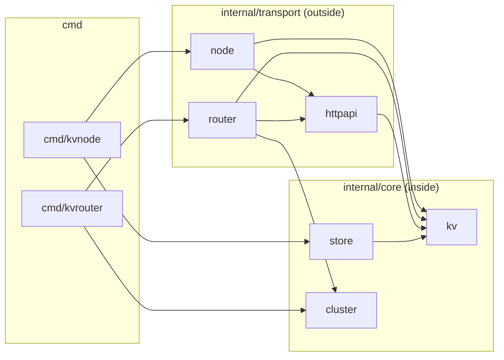

# Project Structure

How the code is laid out, the rules that keep the layers apart, and where new code goes. The rules marked
**(checked)** are enforced by `scripts/check-arch.sh`, which runs as part of `make check`.

Conventions inside the code (errors, logging, tests, comments) are in [`conventions.md`](conventions.md).

---

## 1. Layout

```
kv-store/
├── go.mod                         module github.com/akaradat/kv-store, go 1.27
├── Makefile                       check / test / e2e / run-node / counter / debug-*
├── AGENTS.md  CLAUDE.md           instructions for AI agents (CLAUDE.md imports AGENTS.md)
├── cluster.json                   topology for a kvrouter on the host (nodes on localhost:7001–7003)
├── Dockerfile  compose.yaml       3 nodes + router in containers (topology inline in compose.yaml)
├── .vscode/                       launch configs: kvnode, kvrouter, attach to Delve
│
├── cmd/                           one folder per binary; wiring only
│   ├── kvnode/                    flags/env → store → node handler → http.Server
│   └── kvrouter/                  flags → read cluster.json → router handler → http.Server
│
├── internal/
│   ├── core/                      INSIDE: no net/http, no I/O
│   │   ├── kv/                    rules: Entry, errors, ValidateKey, Merge
│   │   ├── store/                 concurrency engine: atomic Get/Put/Patch/Range
│   │   └── cluster/               topology parse/validate, node IDs, CRC32 → slot → node
│   ├── transport/                 OUTSIDE: everything that speaks HTTP
│   │   ├── httpapi/               shared HTTP contract: parse, validate, write, request log
│   │   ├── node/                  kvnode handler; declares the Store port
│   │   └── router/                kvrouter handler: forward, error mapping, GET /kv fan-out
│   └── servertest/                test helper: in-process node, router, cluster via httptest
│
├── test/                          suites that span packages (unit specs stay next to their code)
│   ├── integration/               router + real nodes in one process; no build tag, always run
│   └── e2e/                       real binaries as processes; every file tagged //go:build e2e (make e2e)
│       └── kvcounter/             required 3×100 counter test: test-client CLI + its Ginkgo spec
├── scripts/                       check-arch.sh (layer rules)
├── docs/
│   ├── requirements/              brief + per-part requirement / solution / decisions / verify
│   ├── standard/                  this file + conventions.md
│   └── roadmap.md                 Part 3 (design only)
└── prep/                          gitignored private study notes; not part of the project
```

---

## 2. Layer rules



1. **`core/` never imports `transport/` or `net/http`.** (checked)
2. **`core/kv` imports nothing from this module.** It is the innermost package. (checked)
3. **`transport/` may import `core/`.** Never the reverse.
4. **`cmd/*` is the only production code that reads flags, env or files** and wires packages together (the
   `test/e2e/kvcounter` test client reads its own flags). `core/cluster`
   takes `[]byte`, not a path, so core does no I/O.
5. **Production code is the stdlib plus chi** (`github.com/go-chi/chi/v5`). No other third-party package may reach a binary. Test code may use
   `ginkgo/v2` and `gomega`, nothing else. (checked)
6. **These folders are never created:** `pkg/`, `util/`, `utils/`, `common/`, `mocks/`, `models/`. (checked)

---

## 3. What each package owns

| Package | Owns | Does not own |
|---|---|---|
| `core/kv` | `Entry{Key, Value, Version}`, `ErrNotFound`, `VersionConflictError`, key rules, the shallow-merge rule (S5) | Locks, HTTP, JSON envelope |
| `core/store` | Directory (`sync.Map`), per-key mutex, immutable snapshots, `ifVersion` check inside the lock, `Range` for listing (S2, S4, S6) | Status codes, validation of input text |
| `core/cluster` | Parsing and validating the topology, node-ID rules, the 1024-slot table, CRC32 key → slot → node (M2–M4) | Reading the file, forwarding |
| `transport/httpapi` | Request-log middleware and the JSON 404 handler, key / `ifVersion` / body parsing and limits, validation order (R-ERR-4), envelope writer (S3), error writer, the error → status mapping | Storage, routing |
| `transport/node` | `kvnode`'s `http.Handler`; the `Store` interface it consumes; NDJSON listing for one node | Locking (delegated to `store`) |
| `transport/router` | `kvrouter`'s `http.Handler`; forwarding with timeouts; node-failure → status mapping; `GET /kv` fan-out (M5–M7) | Storage; slot math (delegated to `cluster`) |
| `servertest` | `StartNode()`, `StartRouter()`, `StartCluster(n)`: real handlers on `httptest` servers, closed by `DeferCleanup` | Anything used by production code |

**The usecase boundary is `store`'s method set.** There is no separate usecase/service layer, because the
`ifVersion` check and the write must happen under the same per-key lock (R-IFV-6). A layer above `store`
could only forward calls, or it would split the check from the write and lose updates.

**There is one interface: `node.Store`**, declared by its consumer. Everything else is concrete. The router
is tested against real in-process nodes, not mocks.

---

## 4. Where new code goes

| You are adding… | Put it in |
|---|---|
| A rule about keys, values or versions | `core/kv` |
| Anything that touches the lock, the directory or snapshots | `core/store` |
| Anything about which node owns a key | `core/cluster` |
| Parsing or writing anything on the HTTP wire, used by node and router | `transport/httpapi` |
| Behaviour only `kvnode` has | `transport/node` |
| Behaviour only `kvrouter` has | `transport/router` |
| A new flag, env var or file read | `cmd/<binary>` |
| A new binary | `cmd/<name>/` |
| A helper used only by tests across packages | `internal/servertest` (or a new `internal/<thing>test`, the stdlib `httptest` pattern) |

A new package under `internal/` needs approval first (see AGENTS.md). Part 3 is design-only, but the layout
already has a place for each likely roadmap item, and nothing existing would move:

| Roadmap item | Policy (inside) | Wire (outside) |
|---|---|---|
| Replication | `core/replication` | `transport/replica` |
| Persistence (WAL) | `core/wal` | — |
| Rebalancing | `core/rebalance` | `transport/admin` |
| Health / metrics | — | `transport/admin` |

---

## 5. Tests

| Level | Where | What |
|---|---|---|
| Unit | `*_test.go` next to the code | `kv` rules, `store` concurrency, `httpapi` parsing, `cluster` slots |
| Package integration | `transport/node`, `transport/router` | One package's handler via `httptest`: node status codes and bodies; router against fake misbehaving nodes |
| System integration | `test/integration/` | The router in front of real in-process nodes: single-node parity, key ownership, node down and restart, `GET /kv` across nodes, key spread |
| End-to-end | `test/e2e/`, tagged `//go:build e2e` | `kvnode`, `kvrouter` and `kvcounter` built with `-race` and run as processes (gomega `gexec`): flags, env, `cluster.json`, startup failures, a crashed node, SIGTERM, the counter test |
| Required counter test | `test/e2e/kvcounter` | `Run()` against an in-process node and an in-process cluster; `make counter` runs it against a live server |

Unit and package-integration specs sit next to the package they test. In-process specs that need the whole
system live in `test/integration/`; they are fast and hermetic, so they carry no build tag and always run. Only
`test/e2e/` is tagged, because it builds binaries and starts processes: `go test -race ./...` (`make test`, part
of `make check`) skips it, and `make e2e` runs it.

---

## 6. Rejected alternatives

| Alternative | Why not |
|---|---|
| Layer folders (`entity/`, `repository/`, `usecase/`, `handler/`, `adapter/`) | Organised for one app with many entities; this is two apps with one entity. `adapter/` overlaps `handler/` and `repository/`. The repository can't be a plain repository because the version check must sit inside the lock. Router code would share folders with node code. |
| A `usecase` / `service` layer | Pass-through or a race (§3). Revisit if Part 3 adds replication, which is real orchestration. |
| Flat `internal/` (no `core/` / `transport/` grouping) | Same packages, but loses the one checkable boundary rule ("only `transport/` speaks HTTP") and the obvious home for new code. |
| `golang-standards/project-layout` (`pkg/`, `api/`, `configs/`, …) | Not an official standard; mostly empty folders at this size. |
